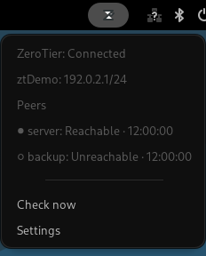

# ZeroTier Indicator for GNOME

GNOME Shell extension that shows ZeroTier status in the top bar.



The screenshot comes from a private headless GNOME Shell with demo data.

## Requirements

- GNOME Shell 46, 47 or 48
- `ip` from `iproute2`
- `glib-compile-schemas` from `libglib2.0-bin`

## Install

```sh
git clone https://github.com/Jamir-boop/zerotier-indicator-gnome-extension.git
cd zerotier-indicator-gnome-extension
./install.sh
gnome-extensions enable zerotier-indicator@jamir-boop.github.io
```

If GNOME cannot find the extension, log out and log in. Then enable it again.

## Use

The extension reads network interfaces with names that start with `zt`. It shows **Connected** when one of these interfaces is up and has an IPv4 address. It does not use `zerotier-cli` or the ZeroTier API.

The menu shows each `zt` interface, its IPv4 addresses, and the peer checks. **Check now** starts a check. **Settings** opens the preferences.

## Settings

- Poll interval: 10 seconds by default.
- Peers: one `label=host` or `label=host:port` value per line. The list is empty by default.
- Default TCP port: 22 by default.

A peer is reachable when a TCP connection opens in 2 seconds. You can also set peers with `gsettings`:

```sh
gsettings --schemadir ~/.local/share/gnome-shell/extensions/zerotier-indicator@jamir-boop.github.io/schemas \
  set org.gnome.shell.extensions.zerotier-indicator peers "['server=10.0.0.2']"
```

## Tests

```sh
gjs -m tests/core.test.js
glib-compile-schemas --strict --dry-run schemas
eslint .
tests/e2e/run.sh
```

`tests/e2e/run.sh` starts a private headless GNOME Shell. It does not use your desktop session or your settings. It also writes `screenshot.png`.

## License

MIT. See `LICENSE`.
